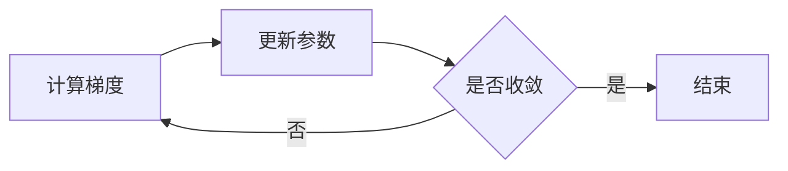

# 知识点详情页说明

更新时间：2026-10-30

## 功能入口

在“我的知识”列表中点击知识点标题、内容区域或“查看详情”，进入：

```text
/knowledge/:id
```

详情页提供返回知识库、编辑、开始费曼复述和生成智能测验等动作。

## 编辑知识点

- 列表中的“编辑”进入 `/knowledge/:id?edit=true`，详情页顶部也可点击“编辑”。
- 编辑弹窗回填标题、正文和标签，复用 `PUT /api/knowledge/:id` 保存。
- 标题、正文去除首尾空白后不能为空；标签支持中英文逗号分隔，去重后最多 8 个，允许清空。
- 保存期间锁定表单与取消操作，并阻止重复提交；请求失败保留输入并展示错误，允许重试。
- 取消或按 Escape 时，有改动会提示是否放弃；刷新或关闭页面时触发浏览器未保存提醒。
- 使用原生模态 dialog 管理焦点和键盘操作，初始焦点在标题框，弹窗内容可滚动。
- 成功后立即更新详情内容与编辑时间，显示“知识点已更新”，清理知识列表、详情与图谱缓存。
- 缓存失效时，已在途的旧请求不再回填缓存，避免覆盖编辑后的内容。
- 更新接口保留原有 owner 校验，仅允许编辑当前用户的知识点；保留复述、测验历史和评分，不修改数据库结构。

## 页面内容

- 知识点标题和标签
- 用户原始理解内容
- 最近编辑时间
- 最近掌握度和复习时间
- 费曼复述历史，包括评分、评价、优点和下一步建议
- 智能测验历史，包括答对和待复习状态

## Markdown、公式与流程图

知识正文在详情页使用 `react-markdown` 渲染；新建和编辑表单均可点击“预览效果”，直接检查排版。

- Markdown：标题、加粗、引用、列表、代码块、链接、图片，以及 GFM 表格和任务列表。
- LaTeX：`remark-math` 识别 `$...$` 行内公式和 `$$...$$` 独立公式，`rehype-katex` 使用 KaTeX 排版。字体与 CSS 随项目打包，无需调用公式服务。
- Mermaid：以 `mermaid` 标注的围栏代码块渲染为图表，同页多张图使用独立 ID。语法错误时显示提示与原始代码，修正后可重新渲染。
- 预览与详情共用组件，保存的仍然是 Markdown 原文，后续编辑回填不会变成 HTML。已有纯文本笔记继续可读。
- 不启用正文原始 HTML；链接沿用 react-markdown 的 URL 过滤。KaTeX 关闭信任模式；Mermaid 使用 strict 模式，并通过 DOMPurify 清理 SVG 后展示。
- Mermaid 组件按需加载，预览计算使用延迟更新，图表输入等待 300 ms 后合并渲染。公式和代码、表格等宽内容在容器内滚动。

可将下面完整示例复制到知识点正文，点击“预览效果”查看：

````markdown
# 梯度下降

**核心思想**：沿梯度反方向更新参数。

- 计算梯度
- 更新参数
- 检查是否收敛

行内公式：$E=mc^2$。

$$
\theta_{t+1}=\theta_t-\eta\nabla J(\theta_t)
$$

| 参数 | 含义 |
| --- | --- |
| eta | 学习率 |


````

实现参考：[react-markdown 官方说明](https://github.com/remarkjs/react-markdown)、[公式插件官方说明](https://github.com/remarkjs/remark-math)、[Mermaid 配置说明](https://mermaid.js.org/config/configuration)。

### 已添加的演示知识点

2026-10-30 经用户授权，通过课程版登录及知识点接口向指定账号新增以下数据；同名演示条目存在时跳过，不覆盖已有内容。

| 标题 | 展示内容 | 知识点 ID |
| --- | --- | --- |
| 【渲染演示】Markdown：费曼学习笔记 | 标题、引用、任务列表、表格和 JavaScript 代码块 | `6ae486a2d669eedf0034fa11` |
| 【渲染演示】LaTeX：梯度下降与均方误差 | 行内公式、独立公式、对齐方程和表格内公式 | `6ae486a4d669eedf0034fa16` |
| 【渲染演示】Mermaid：录音转文字与学习循环 | 带分支的流程图及录音转文字时序图 | `6ae486a5d669eedf0034fa1b` |

三条均已通过详情接口读回验证。若浏览器已缓存知识列表，刷新页面后搜索“渲染演示”即可查看。

## 接口复用

详情页只复用已有接口，没有新增重复的后端模块：

- `GET /api/knowledge/:id`
- `GET /api/feynman/attempts/:knowledgeId`
- `GET /api/quiz/attempts/:knowledgeId`

三个请求通过 `Promise.allSettled` 并行发起。知识点主体加载失败时显示错误状态；历史记录接口单独失败时不阻断知识内容展示。

## 缓存规则

详情数据使用当前登录用户 token 作为缓存作用域，防止不同用户之间复用数据。知识点删除和费曼复述保存后会清理对应详情缓存，避免返回旧内容。

## 交互与可访问性

- 列表主体使用语义化链接，不依赖 hover 才能发现可点击状态。
- 返回入口始终位于详情页顶部。
- 空历史使用明确的下一步动作，而不是只展示空白区域。
- 详情页保留项目现有 Material 3 色彩、圆角和焦点可见规范。
- 移动端详情内容折叠为单列，操作按钮保持可触摸尺寸。

## 验证

执行 `npm run build` 已通过，详情页生成独立异步 chunk `KnowledgeDetailPage`。

2026-10-30 编辑功能验证：

- Vite 生产构建通过。现有知识宇宙模块仍有大于 500 kB 的分包提示，与此次编辑功能无关。
- 使用本机 Edge 无头浏览器运行 `web/tests/knowledge-edit.cjs`，API 请求全部拦截为隔离测试数据，不写入真实数据库。
- 覆盖列表编辑入口、内容回填、空白校验、标签数量限制、失败保留输入和重试、保存中锁定及重复提交保护、保存后详情与列表更新、取消确认、标签清空和刷新读取。
- 覆盖 375×812 手机竖屏和 812×375 横屏弹窗无横向溢出，未出现浏览器运行时异常。
- 缓存并发回归验证：失效前的旧请求晚于新请求返回时，不能覆盖新缓存。

复现方式（在 `course-project/web` 执行，需可用的 Playwright 与本机 Edge；开发服务运行于 5173）：

```powershell
node tests/knowledge-edit.cjs
```

如果 Playwright 位于项目外，可将 `PLAYWRIGHT_MODULE` 环境变量设为其完整模块目录；`TEST_BASE_URL` 可指定知识列表页的测试 URL。

2026-10-30 富文本功能验证：

- `web/tests/knowledge-rich-content.cjs` 使用隔离接口数据验证标题、加粗、列表、普通代码块、GFM 表格、行内及独立公式、同页多张流程图。
- 验证无效流程图回退源码、修正后恢复，正文原始 HTML 与危险链接过滤。
- 验证新建和编辑预览、保存原文、刷新重渲染，以及 375×812 和 812×375 视口无整页横向溢出。
- 原有 `knowledge-edit.cjs` 回归通过，覆盖编辑保存与缓存并发场景；未修改真实数据库。

```powershell
node tests/knowledge-rich-content.cjs
```

构建中 Mermaid 的部分按需图表分包仍超过 500 kB，Vite 会提示包体积警告；主入口保持约 182 kB，图表代码不会进入登录页首屏包。
