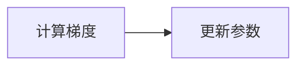

# 第二阶段前端界面与核心交互程序设计文档

费曼学习平台课程版

课程范围：第4至第7次课，共16学时，每次4学时。

文档版本：1.0　编制日期：2026年10月30日

项目目录：D:\AI-SecondBrain\course-project

本文说明课程版前端界面与核心交互的程序设计，包括项目初始化、页面布局、身份认证、知识点管理、富文本显示，以及浏览器录音到百度语音识别的处理链路。文档面向课程评阅与项目维护，给出模块职责、数据与接口约定、异常处理和验收方法。

当前版本已具备登录注册、路由保护、知识点列表与详情、创建编辑、Markdown与公式及流程图渲染，以及录音上传和真实百度语音识别接入。与课程要求尚有差异的内容包括Axios封装、录音暂停与继续，以及录音控件在知识点学习页内的直接呈现；相关补齐方案单独列出，不计为已实现功能。

阅读导览：第1章说明范围与验收；第2章说明架构；第3至8章对应四次课的详细设计；第9章汇总数据与接口；第10章给出测试；第11章说明差异与启动方式；附录提供源码定位。

## 1 项目范围与课程要求对应

### 1.1 设计目标

学习者登录后进入自己的学习工作台，创建并阅读知识笔记，借助格式化内容解释概念，再针对指定知识点录制复述音频，将转录结果用于检查理解。阶段内的数据操作均以当前用户身份为边界，保证知识归属一致。

本阶段只讨论第4至第7次课。AI润色与评价、智能测验、RAG、知识图谱、三维场景和云部署虽然在项目中已有相关模块，但不作为本阶段必需成果；仅说明它们与知识点或复述记录的连接处。

### 1.2 要求对应矩阵

| 课次 | 课程实践要求 | 当前实现与结论 |
| --- | --- | --- |
| 第4次 | Vite创建React项目 | 已配置Vite、React及开发构建命令 |
| 第4次 | 路由与整体布局 | 已实现路由、侧边栏、主内容区及移动端导航 |
| 第4次 | 登录和注册界面 | 已实现，同一登录页通过模式切换显示注册表单 |
| 第5次 | Axios封装与认证API调用 | API调用已实现；封装使用fetch，尚未使用Axios |
| 第5次 | JWT保存及全局状态 | 已实现localStorage与Context API协作 |
| 第5次 | 路由守卫 | 已实现登录恢复等待及未登录重定向 |
| 第6次 | 知识列表和详情 | 已实现，调用后端受保护接口 |
| 第6次 | 创建和编辑表单 | 已实现，编辑支持回填、保存及取消确认 |
| 第6次 | Markdown与LaTeX及Mermaid | 已接入react-markdown、KaTeX及Mermaid |
| 第7次 | 开始和暂停及停止录音 | 已有开始、停止及60秒自动停止；暂停与继续未实现 |
| 第7次 | Blob上传及百度语音识别 | 已接入真实识别SDK，并展示可编辑转录文本 |

### 1.3 录音入口的验收边界

当前知识详情页通过“开始复述”跳转到独立的费曼复述页，并用knowledgeId查询参数选择对应知识点。它形成了可用的学习流程，但录音控件尚未嵌入知识详情页。若按“在知识点学习页面实现录音”进行严格验收，应补充页内入口或明确允许独立复述页。

## 2 总体架构与模块划分

### 2.1 技术架构

程序采用浏览器与服务端分离的结构。React负责显示页面和处理交互，Express提供JSON与音频上传接口，MongoDB Atlas保存用户和知识数据。音频识别凭证只由服务端读取，浏览器不直接调用百度接口。

| 层次 | 技术或模块 | 本阶段职责 |
| --- | --- | --- |
| 页面与组件 | React 18与JSX | 登录、知识管理、富文本及录音界面 |
| 构建与路由 | Vite 5与react-router-dom 6 | 开发代理、生产构建、页面切换与守卫 |
| 全局状态 | Context API | 用户身份、登录恢复与退出 |
| 请求与缓存 | apiRequest及dataCache | Token附加、错误归一、请求合并与失效 |
| 内容渲染 | react-markdown及渲染插件 | Markdown、公式和流程图显示 |
| 音频处理 | MediaRecorder及Web Audio API | 录制、回放、重采样和WAV编码 |
| 后端与存储 | Express及Mongoose | 用户认证、知识归属校验和持久化 |
| 识别服务 | baidu-aip-sdk | 服务端调用百度短语音识别 |

### 2.2 组件与数据关系

```text
BrowserRouter
  AuthProvider                     全局登录身份
    App / ProtectedRoute           路由分发与访问保护
      AppShell                     导航与主内容容器
        KnowledgePage              列表和新建表单
        KnowledgeDetailPage        内容与历史记录
          KnowledgeEditor          编辑弹窗
          MarkdownContent          共用正文渲染
        FeynmanPage                录音和转录文本

页面 → apiRequest → Express接口 → MongoDB Atlas
音频 → Express转录接口 → 百度识别 → 转录文本
```

### 2.3 职责划分原则

页面保存局部表单与交互状态；AuthProvider只处理共享身份。apiRequest集中处理传输约定，dataCache集中管理按用户隔离的请求结果。MarkdownContent由详情与预览共同复用。音频编码放在audio.js，百度识别放在服务端speech.service.js，避免将密钥或第三方SDK逻辑放进React组件。

## 3 第四次课 前端初始化与页面布局

### 3.1 项目初始化设计

web目录以Vite管理React应用，package.json提供dev、build和preview命令。main.jsx负责挂载根节点，组合React.StrictMode、BrowserRouter与AuthProvider；App.jsx负责路由声明。开发页面默认使用5173端口，后端使用4000端口。

本项目已经具备初始化产物，文档不把重新执行脚手架命令作为运行前提。后续维护只需安装既有依赖并启动应用，避免覆盖现有配置。

### 3.2 React核心概念在程序中的应用

| 概念 | 对应程序 | 设计作用 |
| --- | --- | --- |
| 组件与JSX | LoginPage、AppShell | 将页面与导航分解为可组合界面 |
| State | form、loading、saving、error | 记录输入、请求过程与反馈 |
| Props | KnowledgeEditor的knowledge | 由详情页向编辑组件传递业务数据 |
| useEffect | 登录恢复、详情请求、清理录音 | 将外部请求和资源生命周期接入组件 |
| useRef | recorderRef、streamRef、savingRef | 持有录音对象及同步提交锁 |
| Context | AuthProvider与useAuth | 在导航、页面与守卫间共享身份 |

### 3.3 页面路由与布局

| 路径 | 页面或作用 | 访问条件 |
| --- | --- | --- |
| /login | 登录与注册模式切换 | 公开 |
| / | 学习概览 | 已登录 |
| /knowledge | 知识列表与新建 | 已登录 |
| /knowledge/:id | 知识详情 | 已登录且拥有该知识 |
| /knowledge/:id?edit=true | 打开编辑弹窗 | 与详情相同 |
| /feynman?knowledgeId=:id | 指定知识的复述页面 | 已登录 |

AppShell使用Outlet承载子页面，桌面端提供侧边栏，移动端提供顶部用户标识与主要导航。导航使用NavLink显示选中状态，并提供跳转主内容的无障碍链接。

### 3.4 登录注册界面

LoginPage使用mode区分login与register。登录输入邮箱和密码，注册额外输入用户名。前端使用required、邮箱类型和最小长度进行基础校验，提交期间禁用按钮，失败后展示后端错误。服务端仍执行独立校验，前端校验不能代替认证。

## 4 第五次课 前后端请求与身份状态

### 4.1 请求模块约定

web/src/lib/api.js导出apiRequest。其基地址优先读取VITE_API_BASE_URL，普通网页默认使用/api；file协议下使用本机4000端口。调用者传入资源路径、HTTP方法和请求体，由模块统一附加Bearer Token并检查响应状态。

JSON请求附加Content-Type；音频上传使用FormData，由浏览器自动生成multipart边界。成功响应解析为JSON，204响应返回null；失败响应读取message并抛出Error，由页面显示。当前模块没有统一的401拦截退出逻辑，不能把登录过期后的自动退出描述为已完成。

### 4.2 CORS与开发代理

开发时，浏览器向Vite站点的/api发送请求，vite.config.js将其转发至http://localhost:4000。对于显式配置的跨域API地址，服务端使用cors中间件检查Origin与CLIENT_ORIGIN。

当前服务端允许无Origin、Origin为null或与配置相符的来源；CLIENT_ORIGIN为星号时允许任意来源。生产部署宜配置明确来源。CORS只约束浏览器跨源读取，不替代JWT和知识点owner校验。

### 4.3 登录状态与生命周期

登录成功后，服务端返回token和user。AuthProvider将Token写入localStorage的feynman_token键，将user保存到Context，并清空上个身份的缓存。退出时删除Token，清理缓存，再将user设为null。

页面重新打开时，Provider先进入loading状态。有Token时调用GET /api/auth/me恢复用户，没有Token则结束等待。恢复失败会移除Token。当前JWT有效期由服务端设置为7天，不等于支持Token刷新或永久登录。

```text
提交登录表单 → 登录接口校验 → 返回JWT和用户
  → 保存Token与Context用户 → 进入受保护页面

刷新页面 → 检查本地Token → 请求auth/me
  → 成功恢复用户 / 失败清除Token并转到登录页
```

### 4.4 路由守卫与资源权限

ProtectedRoute在身份恢复期间显示等待状态，恢复后依据user决定显示AppShell还是Navigate到/login。服务端requireAuth校验JWT并查询用户；知识接口进一步同时匹配知识ID与owner。访问其他用户的知识也返回404，避免通过详情接口探测资源是否存在。

### 4.5 Axios要求的差异

当前实现完成了请求封装、Token附加和登录注册联调，但使用fetch，因此尚不满足“使用Axios”的指定技术要求。补齐时应保留apiRequest对外接口，将内部传输替换为Axios实例，统一处理baseURL、Bearer头、FormData、204和错误message，并回归所有调用者。此方案属于待实施设计。

## 5 第六次课 知识点管理与编辑交互

### 5.1 列表与详情设计

KnowledgePage通过GET /api/knowledge读取当前用户的知识点，支持按标题、正文和标签在前端筛选。列表显示标题、正文摘要、标签和更新时间，并提供详情、编辑与删除入口。加载失败与空数据分别显示错误或引导信息。

KnowledgeDetailPage按ID读取正文，并并行获取复述和测验历史。请求通过Promise.allSettled组织：正文失败显示错误页面，单个历史接口失败不阻止正文显示。历史失败目前会折算为空数组，因此“没有历史”和“历史读取失败”的提示仍可进一步区分。

### 5.2 创建流程

新建按钮展开表单，填写标题、正文和标签后调用POST /api/knowledge。正文使用KnowledgeContentInput，支持随时展开预览。保存成功关闭表单、清空输入，失效知识列表和图谱缓存，再读取列表。

创建表单使用必填约束，后端继续执行去空白和长度校验。标签创建入口目前按英文逗号拆分；编辑入口已支持中英文逗号。不能将编辑入口的全部增强校验等同于创建入口的现有行为。

### 5.3 编辑流程

详情页的“编辑”或列表链接中的edit=true打开KnowledgeEditor。组件使用原生dialog显示模态表单，自动回填标题、正文与标签，初始焦点位于标题框。取消或Escape在有修改时请求放弃确认，刷新或关闭页面时触发未保存提醒。

编辑保存前对标题和正文去除首尾空白，拒绝空值；标签按中英文逗号分割、去重，最多8个，允许清空。PUT请求只发送可编辑字段，不改写已有复习评分和历史记录。保存失败保留输入；保存期间锁定表单并通过savingRef防止重复提交。

```text
打开编辑 → 回填原文 → 修改并预览 → 校验
  → PUT保存 → 更新详情 → 失效列表与图谱缓存
  → 关闭弹窗并显示成功提示
```

### 5.4 缓存与一致性

dataCache以当前Token作为缓存作用域，避免不同身份共享结果。相同键的在途请求复用同一Promise；编辑、删除和复述保存会按业务失效相关键。失效前发出的旧请求即使较晚返回，也不会再次回填缓存。这套缓存没有自动过期机制；外部工具新增数据后，已打开页面可能需要刷新。

## 6 第六次课 Markdown与公式及流程图渲染

### 6.1 共用渲染组件

MarkdownContent负责将知识正文转换为React内容。react-markdown解析基础Markdown，remark-gfm补充表格与任务列表，remark-math识别数学语法，rehype-katex调用KaTeX生成公式结构。KaTeX样式和字体随前端构建输出。

详情页直接使用MarkdownContent；创建和编辑表单通过KnowledgeContentInput按需展开同一组件。数据库保存的始终是Markdown原文，预览与显示不改变持久化格式，也不需要新增富文本字段。

```text
正文原文 → react-markdown
  → remark-gfm及remark-math → rehype-katex
  → 普通Markdown与公式的React节点
  → mermaid围栏代码块交给MermaidDiagram
```

### 6.2 Mermaid渲染与错误恢复

组件仅将语言标注为mermaid的围栏代码块交给MermaidDiagram，普通代码仍显示为代码。图表组件采用延迟加载，渲染前等待300毫秒以合并连续输入。每次渲染分配独立ID与离屏容器，避免同页多图或过期异步任务相互覆盖。

Mermaid生成SVG后，DOMPurify清理内容，再放入图表区域。渲染失败显示明确提示和原始代码；修正输入后重新渲染。图表提供“查看图表源码”，便于教学中对照语法与效果。

### 6.3 渲染安全与显示策略

正文不启用原始HTML，链接使用react-markdown默认URL过滤并设置新窗口隔离属性。KaTeX关闭trust；Mermaid使用strict模式、关闭HTML标签，并限制文本量与边数。SVG清理为第二层防护，不将任意输入直接当成HTML插入。

表格、代码块和独立公式可在内容容器内横向滚动，图片限制最大宽度，移动端不因长内容撑宽整页。大图表依赖按需打包，部分分包仍有Vite体积警告，尚不能将其表述为体积问题已经完全消除。

### 6.4 录入语法示例

下列为输入语法示例，代码中的美元符号与反引号是需要实际输入的标记。

````markdown
## 梯度下降
**核心思想**：沿下降方向更新参数。
行内公式：$E=mc^2$

$$
\theta_{t+1}=\theta_t-\eta\nabla J(\theta_t)
$$


````

## 7 第七次课 浏览器录音与资源生命周期

### 7.1 入口与状态设计

FeynmanPage读取knowledgeId查询参数，若该ID在用户知识列表内则预选对应知识，否则选择列表第一项。没有知识点时显示创建引导，不进入录音。使用isRecording、audioUrl、transcript、busy等状态组合驱动录音、上传和文字显示。

| 阶段 | 主要状态或资源 | 已实现交互 |
| --- | --- | --- |
| 准备 | 已选知识且无音频 | 开始录音 |
| 录音中 | MediaRecorder和MediaStream | 计时、停止；锁定知识点选择 |
| 已停止 | Blob与audioUrl | 音频回放、重新录音、上传转文字 |
| 转录中 | busy为true | 显示等待并禁用上传 |
| 已转录 | transcript非空 | 展示可修改的文字 |
| 暂停 | 当前无对应状态 | 待增加暂停与继续操作 |

### 7.2 开始与停止的处理

开始前检查getUserMedia和MediaRecorder支持情况，再请求音频权限。创建MediaRecorder后收集dataavailable产生的分块，调用start开始录制。每秒更新计时，到60秒触发停止。

停止时调用recorder.stop，onstop将分块合成为Blob，创建对象URL供audio控件回放。实际媒体类型优先采用recorder.mimeType，不能假定所有浏览器都生成同一种编码。权限拒绝或录音异常时展示错误并释放资源。

### 7.3 清理与知识归属

录音期间禁用知识点下拉框，避免录音完成后被错误归到其他知识。停止、异常和页面卸载时清理计时器、停止MediaStream全部track；对象URL被替换或页面卸载时撤销。录音原文件只用于当前会话，后端不将其写入知识集合。

生产环境需要满足浏览器麦克风API的安全上下文要求，建议通过HTTPS访问；本机开发可使用localhost。用户仍需主动允许麦克风权限。

### 7.4 暂停与继续的待实现设计

课程要求暂停录音，当前源码尚未调用MediaRecorder.pause或resume。补齐时应增加recording与paused状态；暂停时停止有效录音时长累计、保留分块且继续锁定知识点；继续时恢复录音和计时；停止时允许从录音或暂停状态结束并统一释放资源。

暂停不等于释放麦克风权限或关闭音轨，需要在界面明确显示。验收时应验证多次暂停继续后的音频可播放、总有效录音时间不超过限制，以及在暂停状态离开页面仍能关闭音轨。

## 8 第七次课 音频上传与百度语音转文字

### 8.1 音频格式转换

浏览器录音产生的Blob不能直接假定满足识别服务要求。audio.js使用AudioContext解码，再通过单声道OfflineAudioContext以16000Hz重采样，并写入16位PCM的WAV文件头和样本数据。处理完成后关闭音频上下文，释放资源。

一分钟单声道16kHz、16位PCM的裸数据约为1.92MB，另加44字节WAV头。这个估算用于解释当前音频规模，不作为客户端真实性校验；服务端现有文件大小保护为10MB。

### 8.2 上传与服务端处理链路

前端将knowledgeId和WAV Blob加入FormData，文件字段名为audio，文件名为feynman-rehearsal.wav。POST /api/feynman/transcribe携带Bearer Token，apiRequest不手工指定multipart的Content-Type边界。

服务端先执行requireAuth，再用Multer memoryStorage接收文件。路由校验文件存在、MIME类型和知识归属；百度配置缺失时明确返回503。speech.service.js构造百度SDK客户端，使用wav、16000Hz与普通话模型参数dev_pid 1537发起识别。

```text
学习者停止录音
  → 浏览器合成Blob并转换16kHz WAV
  → FormData上传到Express
  → 身份与文件及知识归属校验
  → 服务端调用百度短语音识别
  → 返回transcript与provider
  → React显示转录文字供检查
```

### 8.3 响应与异常设计

成功响应包含transcript、provider为baidu-asr，以及当前固定为null的durationMs。前端读取transcript放入可编辑textarea，允许识别后人工纠正。识别完成并不自动保存复述记录；AI评价和保存属于后续动作。

无音频或不支持的MIME返回400，知识不归属当前用户返回404，百度凭证未配置返回503。SDK网络、服务异常、无识别文字或超时统一通过SpeechProviderError转为502，并保留用户可理解的错误提示。

### 8.4 当前校验边界

60秒限制主要由前端实现，服务端尚未按WAV头独立验证声道数、采样率和时长；MIME过滤也不能代替音频内容校验。超大文件会触发Multer限制，但当前统一错误处理中尚未专门将该错误映射为413，需作为后续增强项。

服务端使用超时包装限制等待时间；该包装不意味着底层SDK网络请求已经被取消。凭证不得写入前端、Word文档或公开仓库。

## 9 数据结构与接口约定

### 9.1 核心持久化数据

| 对象与字段 | 类型或约束 | 用途 |
| --- | --- | --- |
| User.username | 字符串2至40字符，唯一索引 | 展示学习者身份 |
| User.email | 小写邮箱，唯一 | 登录标识 |
| User.passwordHash | 密码哈希 | 不在JSON中返回 |
| Knowledge.owner | 用户ObjectId，必填且有索引 | 资源归属 |
| Knowledge.title | 字符串，最长120字符 | 知识标题 |
| Knowledge.content | 字符串，最长30000字符 | Markdown原文 |
| Knowledge.tags | 字符串数组 | 分类检索；接口最多保留8项 |
| reviewScore与lastReviewedAt | 可空数值与日期 | 承接后续复述结果 |
| createdAt与updatedAt | 自动时间戳 | 创建及最近修改时间 |

知识序列化时将_id转换为id，并移除owner与__v。音频不持久化到上述对象；服务端只在请求处理期间持有内存Buffer。原始知识正文和复述文字属于不同业务数据，不能相互覆盖。

### 9.2 本阶段接口清单

所有路径以下列/api前缀访问。除注册和登录外均需要Bearer Token。

| 方法与路径 | 输入要点 | 成功响应 |
| --- | --- | --- |
| POST /auth/register | username、email、password | 201，token与user |
| POST /auth/login | email、password | 200，token与user |
| GET /auth/me | Authorization请求头 | 200，user |
| GET /knowledge | 当前用户身份 | 200，items数组 |
| GET /knowledge/:id | 路径id | 200，item对象 |
| POST /knowledge | title、content、tags | 201，item对象 |
| PUT /knowledge/:id | 完整可编辑字段 | 200，item对象 |
| DELETE /knowledge/:id | 路径id | 204，无响应体 |
| POST /feynman/transcribe | multipart的audio和knowledgeId | 200，transcript与provider |

### 9.3 状态码与调用注意

认证缺失或失效返回401；登录密码错误也返回401。注册邮箱或用户名冲突返回409。普通知识请求校验失败使用400，但Mongoose校验及无效ObjectId当前可能落入500，尚需分类映射。调用者应读取message，避免只根据HTTP状态臆测知识是否存在。

Apifox与浏览器测试必须使用同一账号、同一后端和该账号列表返回的id。用户不同或owner不匹配时，即使数据库存在记录，详情接口仍返回404。

## 10 测试设计与验收证据

### 10.1 已执行验证

2026年10月30日，知识编辑与富文本改动完成生产构建。knowledge-edit.cjs使用隔离接口数据验证回填、校验、失败重试、重复提交保护、取消确认、列表刷新和缓存并发。knowledge-rich-content.cjs验证Markdown、表格、行内及独立公式、多张流程图、错误恢复、原文保存和移动端显示。

另已在用户指定账号添加三条带“渲染演示”前缀的笔记，接口读回确认保存，并使用真实页面验证Markdown、公式及流程图显示。该操作验证内容展示，不等于本次重新验证了麦克风设备或百度识别服务。

百度识别链路已有项目联调记录，当前源码确认调用真实SDK。本文不将历史联调等同于本次实测；正式阶段验收仍应在当前设备上执行完整录音与转录，并检查返回provider。

### 10.2 验收测试用例

| 编号 | 操作与检查点 | 当前证据或状态 |
| --- | --- | --- |
| T01 | 未登录打开知识列表应转到登录 | 已有守卫源码，需现场回归 |
| T02 | 登录后刷新恢复用户 | 已有Context与auth/me链路 |
| T03 | 注册重复邮箱或错误密码 | 后端分别返回409或401 |
| T04 | 创建笔记后进入详情再编辑 | 编辑回归及真实演示数据已验证 |
| T05 | 保存失败后保留输入并重试 | 自动化回归通过 |
| T06 | Markdown与表格及代码块排版 | 自动化及真实页面显示通过 |
| T07 | 行内与独立LaTeX公式 | 自动化及真实页面显示通过 |
| T08 | 多图渲染及错误Mermaid恢复 | 自动化回归通过 |
| T09 | 保存后旧请求不覆盖新缓存 | 自动化并发回归通过 |
| T10 | 375像素竖屏及横屏不撑宽页面 | 富文本回归通过 |
| T11 | 录音停止或离页后音轨结束 | 清理逻辑已实现，需设备回归 |
| T12 | 暂停与继续后音频连续可播 | 尚未实现，当前不能通过 |
| T13 | Blob上传并返回baidu-asr文字 | SDK已接入，需当前环境真实录音验收 |

### 10.3 测试边界

受控接口测试证明页面和状态流转，不证明数据库或外部服务始终可用。真实录音验收需同时满足麦克风权限、设备可用、后端网络和百度应用配置；不应将模拟转录结果作为真实语音识别的验收证据。

## 11 差异补齐与运行说明

### 11.1 优先补齐事项

| 顺序 | 待完成项 | 建议改动与验收标准 |
| --- | --- | --- |
| 1 | Axios请求封装 | 保留apiRequest调用约定；登录、知识CRUD、上传均回归通过 |
| 2 | 暂停与继续录音 | 接入pause与resume、有效时长统计、暂停状态退出清理 |
| 3 | 页内录音入口 | 将复述面板复用到详情或确认独立复述页验收口径 |
| 4 | 输入与错误分类增强 | 服务端校验WAV内容、时长及大小，补充400与413等映射 |

以上属于补齐设计，不在本次文档任务中改动应用代码。现有编辑与富文本能力可以直接演示，不能据此将全部第二阶段要求标为无差异完成。

### 11.2 本地启动

分别在两个终端启动后端和前端。首次运行先按锁文件安装依赖，正常维护不要重新创建Vite项目。

```powershell
cd D:\AI-SecondBrain\course-project\server
npm ci
npm run dev
```

```powershell
cd D:\AI-SecondBrain\course-project\web
npm ci
npm run dev
```

后端通过server/.env读取MongoDB Atlas连接配置、JWT_SECRET、CLIENT_ORIGIN和百度语音配置。百度相关变量为BAIDU_APP_ID、BAIDU_API_KEY、BAIDU_SECRET_KEY与可选的BAIDU_ASR_TIMEOUT_MS；文档不包含真实值。

### 11.3 演示顺序

登录课程账号，打开“我的知识”，搜索“渲染演示”；依次查看Markdown、LaTeX和Mermaid笔记，再进入编辑预览并保存。随后从知识详情进入“开始复述”，录制短讲解，停止并回放，点击“上传并转成文字”，检查文本与实际讲述一致。暂停功能应在补齐后单独演示。

构建命令为web目录下的npm run build。开发回归脚本为tests/knowledge-edit.cjs和tests/knowledge-rich-content.cjs，需要可用的Playwright和Edge；这些不是浏览器正常访问应用的运行依赖。

## 附录 源码与资料定位

以下路径均相对于D:\AI-SecondBrain\course-project。表中对应关系用于评阅时快速定位，不包含任何账号密码或访问凭证。

| 文件 | 对应设计内容 |
| --- | --- |
| web/package.json及vite.config.js | 技术依赖、运行命令与开发代理 |
| web/src/main.jsx及App.jsx | 应用入口、懒加载路由与守卫 |
| web/src/components/AppShell.jsx | 导航、用户入口和响应式布局 |
| web/src/pages/LoginPage.jsx | 登录注册模式和表单 |
| web/src/context/AuthContext.jsx | JWT持久化与身份恢复 |
| web/src/lib/api.js及dataCache.js | 请求封装、缓存隔离和并发保护 |
| web/src/pages/KnowledgePage.jsx | 知识列表、创建与删除 |
| web/src/pages/KnowledgeDetailPage.jsx | 详情、历史记录和编辑入口 |
| web/src/components/KnowledgeEditor.jsx | 编辑回填、校验、保存和取消 |
| web/src/components/KnowledgeContentInput.jsx | 正文输入与共用预览 |
| web/src/components/MarkdownContent.jsx | Markdown与公式渲染 |
| web/src/components/MermaidDiagram.jsx | 流程图渲染与错误恢复 |
| web/src/pages/FeynmanPage.jsx | 录音、回放、上传和文本展示 |
| web/src/lib/audio.js | 16kHz单声道WAV编码 |
| server/src/routes/auth.routes.js | 登录注册及当前用户接口 |
| server/src/routes/knowledge.routes.js | 知识点CRUD和owner校验 |
| server/src/routes/feynman.routes.js | 文件接收与转录入口 |
| server/src/services/speech.service.js | 百度SDK调用和超时处理 |

课程依据为项目docs/feature-new中的教学大纲及第4至第7次课程资料。本文关于实现状态的判断以当前课程版源码为准；历史检测报告用于理解修复背景，不能覆盖当前源码事实。

相关专项说明：docs/knowledge-detail.md记录编辑和富文本实现及演示数据；docs/baidu-asr-integration.md记录百度接入；docs/performance-optimization.md记录前端加载与缓存优化。
